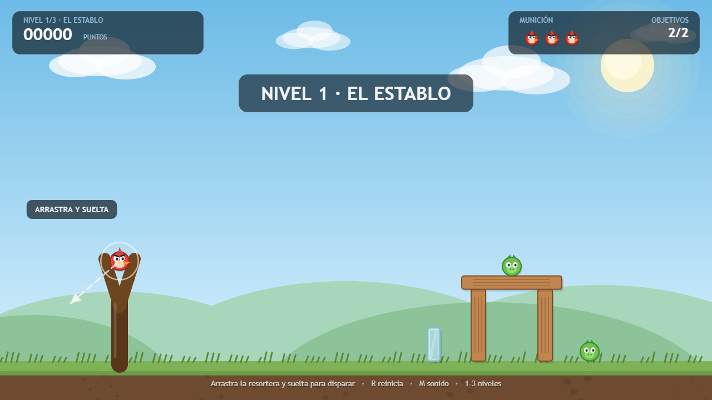
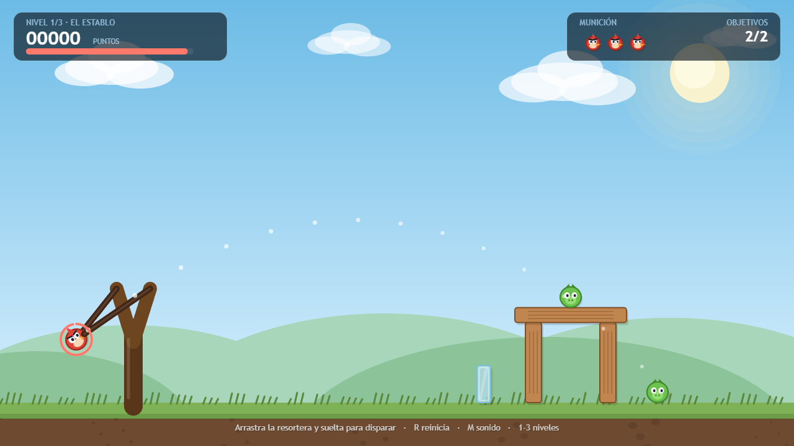
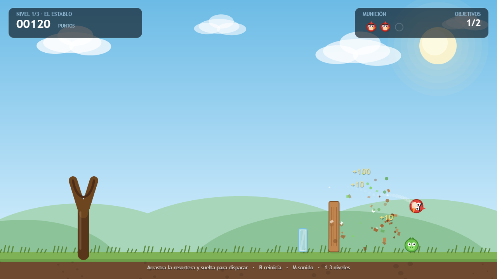
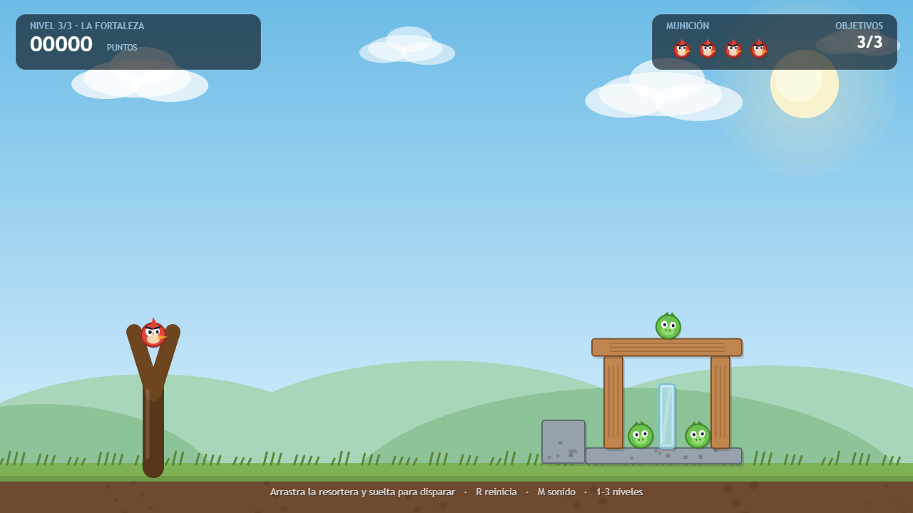
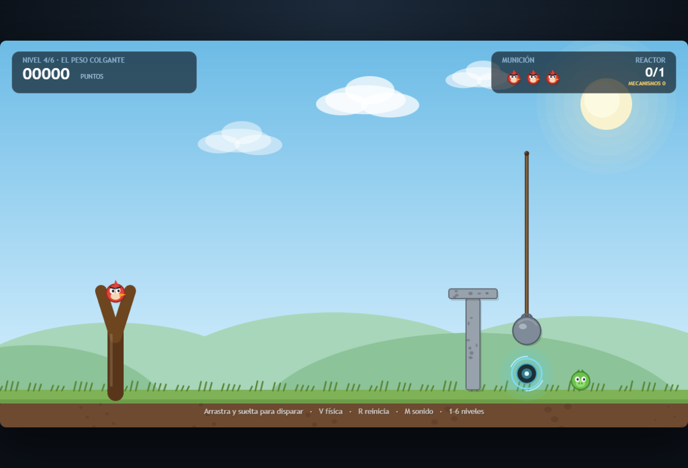
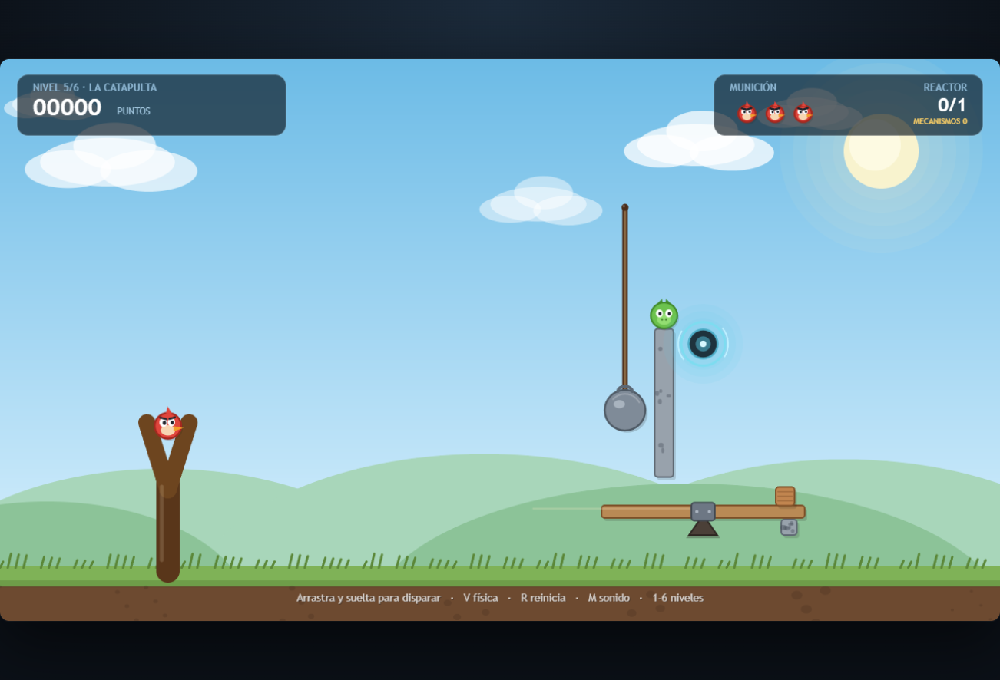
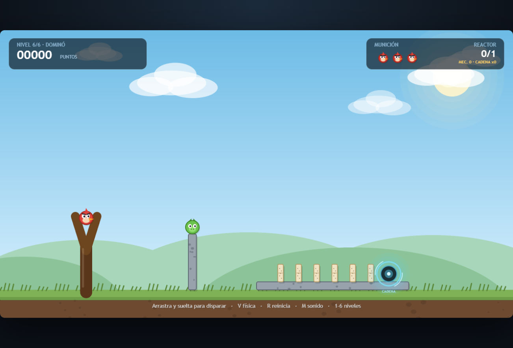
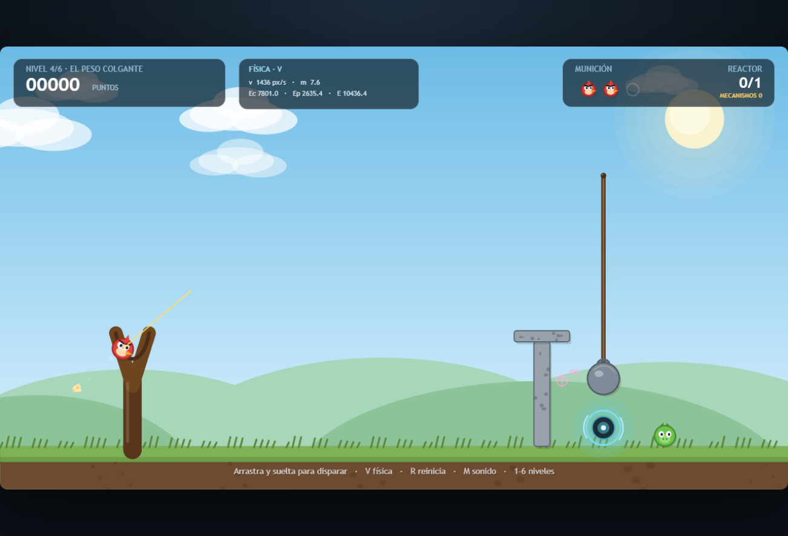

# Resortera vs. Torre — reacción en cadena

Juego 2D de **física** hecho con **p5.js** (dibujo) y **matter.js** (motor de cuerpos rígidos).
Se lanza un proyectil con una resortera para derribar estructuras y, en los niveles nuevos,
para **encadenar mecanismos** (cuerdas, palancas y dominós) hasta activar un reactor.

El juego no usa imágenes ni archivos de audio: **todo el arte se dibuja por código** y los
efectos de sonido se **sintetizan con WebAudio**.

## Modos de juego

El menú principal separa los cuatro modos:

| Modo | Estado | Contenido |
|---|---|---|
| **Aventura** | Campaña validada automáticamente | 5 mundos temáticos × 12 niveles; cinco vidas iniciales ampliables con corazones, estrellas y jefes |
| **Hardcore** | Jugable | Campaña en orden, una vida, mínimo 3 estrellas para avanzar y récord de run |
| **Infinito** | Jugable | Generación determinista validada (5 semillas × 50 niveles), semillas, mutadores y ranking local |
| **Clásico** | Jugable | Los 6 niveles originales, con su puntuación y sus récords |

La campaña contiene 60 niveles de Aventura con estructuras y campos declarados por nivel. Los 60
tienen solución de referencia en la búsqueda determinista del simulador; los resultados y sus
límites están en [docs/validacion.md](docs/validacion.md). El Clásico sigue separado y conserva sus
seis niveles originales.

En **Aventura** empiezas con cinco vidas, compartidas durante la partida y sin límite máximo. Si se
agotan todos los proyectiles sin completar el objetivo, pierdes una vida y repites el mismo nivel;
al perder la última aparece **Game Over**. Al comenzar otra partida tras Game Over, reinicias ese
mundo desde el nivel 1 con cinco vidas. Cada corazón recogido en Aventura añade una vida y conserva
su tiro extra, pero solo puede dar esa vida una vez por partida. Las estrellas y niveles desbloqueados
se conservan.

**Hardcore** recorre los 60 niveles en orden. Los tiros sobrantes no se arrastran, `R` no reinicia
un nivel y cualquier derrota —incluido no alcanzar 3 estrellas— termina la run. **CONTINUAR** vuelve
al siguiente nivel ya superado; si se cierra la pestaña durante un nivel, ese nivel se vuelve a
empezar. El mejor run y el historial de diez partidas usan el guardado v2.

**Infinito** admite semilla aleatoria, manual (decimal o `0x` hexadecimal de 32 bits) y diaria
(hash de la fecha local `AAAA-MM-DD`), además de copiar/compartir la semilla. Cada nivel se deriva
de la semilla y el índice, se valida en segundo plano con una malla 24 × 4 y se descarta si no
supera las comprobaciones de gracia, solución y trivialidad. Los jefes conservan la arena calibrada
de su mundo y se validan con secuencias que cambian ángulo, potencia y munición después de cada
teletransporte; como su definición es determinista, no se repiten doce intentos idénticos. Los
niveles de reactor reutilizan el mecanismo de su estructura o colocan uno solo, para evitar
objetivos duplicados. Tras agotar los intentos se usa una plantilla de respaldo que también se
valida. La racha conserva hasta cinco tiros de reserva, sortea un mutador cada cinco niveles y
guarda rankings globales y por semilla. El lote de aceptación de 5 semillas × 50 niveles validó
los 250 niveles sin fallos ni respaldos.
La dificultad de los niveles normales crece de forma determinista con la profundidad: suben la
intensidad de los campos y el presupuesto, se favorecen estructuras más exigentes y aumenta por
tramos el límite de campos (hasta cuatro). Los jefes mantienen la arena e intensidad base de su
mundo para conservar su calibración.

## Vista del juego

| Inicio (con la pista del primer disparo) | Apuntando (trayectoria prevista) |
|---|---|
|  |  |

| Impacto (partículas, puntos y derrumbe) | Nivel 3: La fortaleza |
|---|---|
|  |  |

| Nivel 4: El peso colgante | Nivel 5: La catapulta |
|---|---|
|  |  |

| Nivel 6: Dominó | Overlay de física (`V`) |
|---|---|
|  |  |

---

## 1. Cómo ejecutarlo

Dos opciones, ninguna requiere instalar nada.

**Opción A — doble clic**

Abre `index.html` en el navegador. Las librerías están en `lib/`, así que funciona sin internet.

**Opción B — servidor local (recomendado si el navegador bloquea algo en `file://`)**

```bash
node serve.js          # http://localhost:8123
```

El servidor no tiene dependencias: es un `http` de Node que sirve la carpeta del proyecto.

### Herramientas de validación (Node)

Matter.js se carga desde `lib/matter.min.js`; no se instalan dependencias.

```bash
node tools/tests.js
node tools/sim.js --level 3-7
node tools/sim.js --all
```

`js/core.js` ejecuta la misma clase `Game` en modo headless: juego, simulador y validador del
generador comparten actualización, colisiones, campos, munición y victoria en Matter.js a paso
fijo. `tools/sim.js --all` conserva la búsqueda de campaña con workers; `--quick` usa una malla
reducida y **no** genera el informe oficial. `tools/tests.js` comprueba determinismo de un disparo,
datos de campaña, persistencia, vidas y reinicio por mundo en Aventura, variedad de niveles por
semilla y los efectos físicos de la munición especial, incluido el movimiento de los fragmentos al
dividirse.
El validador de Infinito trabaja entre frames para evitar bloquear la interfaz. Las búsquedas son
heurísticas y no certifican un mínimo global ni sustituyen el playtesting humano. La validación
completa previa de Aventura tardó 152,81 s para los 60 niveles.

Navegadores probados: Chrome / Edge / Firefox actuales. También funciona con pantalla táctil.

---

## 2. Controles

| Acción | Control |
|---|---|
| Apuntar | Arrastrar el proyectil (ratón o dedo) |
| Disparar | Soltar el arrastre |
| Reiniciar nivel | `R` |
| Siguiente nivel | `N`, `Enter` o `Espacio` (tras ganar) |
| Cambiar de nivel en Clásico | `1`, `2`, `3`, `4`, `5`, `6` |
| Abrir el menú | `Esc` |
| Navegar por menús y tarjetas | Flechas + `Enter`, o clic/táctil |
| Atajos de menú | `1`–`9` para la tarjeta o el nivel correspondiente |
| Overlay de física | `V` |
| Silenciar | `M` |
| Continuar / reintentar | Clic sobre el panel final |
| Continuar una partida pausada | Botón `CONTINUAR` del menú principal o `C` |

`Esc` abre el menú sin borrar la partida; el botón **CONTINUAR** vuelve exactamente al punto
en el que se dejó. Si se elige otro modo o nivel, la partida anterior se descarta.

En **Hardcore**, `R` está desactivada y un nivel no se puede reintentar; los corazones solo añaden
tiros en ese nivel. En **Infinito**, los tiros sobrantes se convierten en una reserva compartida de
hasta cinco para el nivel siguiente.

El estiramiento máximo de la goma es de 125 px y define la **potencia** del disparo:
cuanto más lejos arrastres, más rápido sale el proyectil. Mientras arrastras se muestra la
**trayectoria prevista** y un anillo de potencia.

---

## 3. Objetivo y reglas

Hay tres tipos de objetivo:

- **Demolición** (`destroyAll`, niveles clásicos 1–3): deben desaparecer todos los objetivos
  verdes.
- **Reactor** (`switch`, niveles clásicos 4–6): hay que activar uno o varios reactores (orbes
  de energía).
  El reactor es un **sensor**: no se destruye, se activa con un impacto suficientemente rápido y
  pesado. En el nivel 6 solo lo activa un cuerpo de la cadena, no el proyectil.
- **Jefe** (`boss`, nivel 12 de cada mundo): el guardián tiene una vida propia. Cada impacto
  válido le resta un golpe, lo teletransporta a otra posición y levanta un obstáculo nuevo.
  En el Mundo 1 tiene **3 golpes**, 6 tiros y par 4.

Reglas comunes:

- Si te quedas **sin tiros** y el objetivo no está cumplido, la estructura aguanta 2,2 s más
  (por si sigue derrumbándose) y luego se declara la derrota.
- Puedes ganar en cualquier momento, incluso con el último tiro en el aire.
- Los objetivos se destruyen por impacto directo, por la caída de la estructura o al caer fuera
  del escenario.
- Los **corazones** son opcionales: solo los recoge el proyectil al tocarlos, dan **+1 tiro** y
  **+150 puntos**, y el tiro extra cuenta para las estrellas si se usa. En Aventura también añaden
  una vida, una sola vez por corazón en cada partida. Su contador aparece en el HUD, debajo del nivel,
  y la munición extra se añade a la fila de tiros.

**Puntuación**

| Acción | Puntos |
|---|---:|
| Objetivo destruido | +100 |
| Bloque destruido | +10 |
| Cuerda cortada | +25 |
| Palanca activada | +25 |
| Reactor activado | +100 |
| Ficha de dominó derribada | +5 |
| Corazón recogido | +150 |
| Golpe válido al jefe | +250 |
| Estrella conseguida al ganar (modos nuevos) | +200 |
| Tiro sin usar al ganar | +50 |

**Puntuación especial**

- Hardcore: puntaje del run = suma de puntajes de nivel + 100 por nivel superado + 200 por jefe.
  Cada golpe a jefe también vale el doble de `SCORE_BOSS_HIT`. Se requiere un mínimo de 3 estrellas
  para guardar el checkpoint del siguiente nivel.
- Infinito: puntaje de la racha = 100 por nivel completado + 50 por estrella + 25 por tiro
  sobrante + puntos del juego. Al terminar una racha, se añade al ranking global y al de su semilla.

El récord y las **estrellas** se guardan por nivel en `localStorage`
(`resortera_vs_torre_save_v2`).

**Estrellas**

Cada nivel tiene un **par** de tiros. En los 6 niveles clásicos el par es
`tiros disponibles − 1`; los niveles nuevos pueden definir su propio `par`.

```text
estrellas = 5                                si tirosUsados <= par
estrellas = max(1, 5 - (tirosUsados - par))  si se usan más tiros
```

- 5 estrellas es el resultado perfecto.
- Se guardan las mejores estrellas y el mejor puntaje de cada nivel.
- El HUD muestra `MEJOR x/5` y el panel final dibuja las estrellas conseguidas.
- En Aventura cada mundo suma 60 estrellas (12 niveles × 5); el total es 300.
- En Clásico cada nivel suma 5 estrellas; el total es 30.
- En los modos nuevos, las estrellas y los corazones también suman puntos; los corazones
  suman en el momento de recogerlos y no se vuelven a sumar al ganar. En Clásico se mantiene
  la puntuación original y no hay corazones.
- Al superar un nivel se desbloquea el siguiente. Al superar el nivel 12 (el jefe) de un mundo
  se abre el mundo siguiente desde su nivel 1.

**Seis niveles originales del modo Clásico**

Estas descripciones corresponden al modo Clásico y no a los niveles de Aventura, que tienen una
progresión independiente de 12 niveles por mundo (ver tablas de campaña).

1. **El establo** — dos columnas, un dintel y dos objetivos. Nivel tutorial (3 tiros).
2. **Doble torre** — base de piedra, torre de madera y un objetivo en equilibrio sobre una
   columna de vidrio (4 tiros).
3. **La fortaleza** — caja de madera cerrada con dos objetivos dentro y uno en el techo, más un
   escudo de piedra que obliga a buscar ángulos (4 tiros).
4. **El peso colgante** — un peso de piedra cuelga de una cuerda sobre un reactor. Hay que cortar
   la cuerda **por encima del peso** para que caiga recto; si el proyectil empuja el peso, se
   desvía y falla. Un escudo de piedra protege el reactor de los tiros bajos (3 tiros).
5. **La catapulta** — el peso cae sobre el brazo izquierdo de una palanca; el brazo derecho
   lanza un bloque ligero contra un reactor elevado. La palanca tiene un tope para empezar
   nivelada y el bloque debe salir despedido, no resbalar (3 tiros).
6. **Dominó** — hay que colar el tiro por encima de un muro de piedra y derribar la cadena de
   fichas. La última ficha (o el impulso de la cadena) activa un reactor que **ignora al
   proyectil**: la reacción tiene que llegar por los dominós (3 tiros).
**Pistas de los niveles clásicos 4–6**

- Nivel 4: apunta alto y corta la cuerda cerca del anclaje; el peso debe caer sin recibir un
  empujón lateral.
- Nivel 5: el peso tiene que golpear el brazo izquierdo de la palanca. El bloque del brazo
  derecho sale hacia arriba y a la izquierda; el reactor está en esa trayectoria.
- Nivel 6: el muro está antes de la cadena. Un tiro demasiado bajo choca con el muro; uno
  demasiado alto pasa por encima de las fichas. Busca la parábola intermedia.

### Campaña Aventura: conceptos, tiros y par

Cada mundo aporta 60 estrellas (12 × 5; 300 en total). Los pares se ajustaron a partir de los tiros
mínimos encontrados por el simulador, acotados entre `shots − 2` y `shots − 1`. Las soluciones de
referencia y la fracción de malla ganadora están en [docs/validacion.md](docs/validacion.md).

**Mundo 1 — Pradera**

| Nivel | Concepto físico | Tiros | Par |
|---|---|---:|---:|
| 1-1 Deriva en la pradera | Viento: fuerza, aceleración y deriva según la masa | 3 | 1 |
| 1-2 La poza tranquila | Agua: empuje de flotación y arrastre | 3 | 1 |
| 1-3 Ritmo de la meseta | Plataforma móvil: periodo y fase | 3 | 2 |
| 1-4 Contrapesos gemelos | Polea de Atwood y ventaja mecánica | 3 | 1 |
| 1-5 Pozo de gravedad | Campo gravitatorio y zona de gravedad distinta | 3 | 1 |
| 1-6 Impacto pesado | Demolición con proyectil pesado y momento lineal | 4 | 2 |
| 1-7 Cadena al viento | Dominós, reactor y viento | 4 | 2 |
| 1-8 Péndulo del roble | Péndulo, plano inclinado y transferencia de energía | 4 | 2 |
| 1-9 Corazón entre campos | Corazón opcional, viento y pozo gravitatorio | 4 | 2 |
| 1-10 Ruedas y rampas | Rozamiento e inercia de ruedas macizas/huecas | 4 | 2 |
| 1-11 Gran reacción | Combo de viento, pozo, plataforma y dos reactores | 6 | 4 |
| 1-12 El guardián | Jefe de tres golpes, teletransporte y obstáculos | 6 | 4 |

**Mundo 2 — Cañón de arena**

| Nivel | Concepto físico | Tiros | Par |
|---|---|---:|---:|
| 2-1 Brisa de las dunas | Viento y deriva dependiente de la masa | 3 | 1 |
| 2-2 La poza del cañón | Flotabilidad y arrastre en agua | 3 | 1 |
| 2-3 Meseta oscilante | Plataforma móvil: periodo y fase | 3 | 2 |
| 2-4 Atwood de piedra | Polea de Atwood y ventaja mecánica | 3 | 1 |
| 2-5 Vórtice del desierto | Pozo y zona de gravedad | 3 | 2 |
| 2-6 Asedio de arena | Demolición y momento del proyectil pesado | 4 | 2 |
| 2-7 Dominó de la garganta | Dominós, reactor y viento | 4 | 2 |
| 2-8 Péndulo de la mina | Péndulo y conversión de energía | 4 | 2 |
| 2-9 Oasis de dos corrientes | Corazón opcional, viento y pozo | 4 | 2 |
| 2-10 Espejo del mediodía | Reflexión del láser y péndulo de Newton | 4 | 2 |
| 2-11 Tormenta encadenada | Combo de viento, pozo, plataforma y dos reactores | 6 | 4 |
| 2-12 El centinela del viento | Jefe de tres golpes; cambia dirección y fuerza del viento | 6 | 4 |

**Mundo 3 — Puerto y arrecife**

| Nivel | Concepto físico | Tiros | Par |
|---|---|---:|---:|
| 3-1 Brisa del puerto | Viento y deriva dependiente de la masa | 3 | 1 |
| 3-2 Marea de cristal | Flotabilidad y arrastre en agua | 3 | 2 |
| 3-3 Plataforma de coral | Plataforma móvil: periodo y fase | 3 | 2 |
| 3-4 Contrapeso de marea | Polea de Atwood y ventaja mecánica | 3 | 1 |
| 3-5 Pozo abisal | Pozo y zona de gravedad | 3 | 1 |
| 3-6 Impacto en el muelle | Demolición y momento del proyectil pesado | 4 | 2 |
| 3-7 Dominó de la corriente | Dominós, reactor y corriente de agua | 4 | 2 |
| 3-8 Péndulo del faro | Péndulo y conversión de energía | 4 | 2 |
| 3-9 Corazón de dos mareas | Corazón opcional, agua y pozo | 4 | 2 |
| 3-10 Hielo y fuego | Fricción al derretirse y explosión decreciente | 4 | 2 |
| 3-11 Marea encadenada | Combo de agua, pozo, plataforma y dos reactores | 6 | 4 |
| 3-12 El kraken de marea | Jefe de tres golpes; cada golpe eleva el agua | 6 | 4 |

**Mundo 4 — Fábrica**

| Nivel | Concepto físico | Tiros | Par |
|---|---|---:|---:|
| 4-1 Viento de la fábrica | Viento y deriva dependiente de la masa | 3 | 1 |
| 4-2 Canal de enfriamiento | Flotabilidad y arrastre en agua | 3 | 1 |
| 4-3 Elevador rítmico | Plataforma móvil: periodo y fase | 3 | 2 |
| 4-4 Polea de fundición | Polea de Atwood y ventaja mecánica | 3 | 1 |
| 4-5 Pozo de la caldera | Pozo y zona de gravedad | 3 | 1 |
| 4-6 Demolición de acero | Demolición y momento del proyectil pesado | 4 | 2 |
| 4-7 Cadena de engranajes | Dominós, reactor e imán | 4 | 2 |
| 4-8 Péndulo de vapor | Péndulo y conversión de energía | 4 | 2 |
| 4-9 Corazón de dos campos | Corazón opcional, imán y pozo | 4 | 2 |
| 4-10 Circuito electromagnético | Electroimán y circuito lógico AND/OR | 4 | 2 |
| 4-11 Gran circuito | Combo de imán, pozo, plataforma y dos reactores | 6 | 4 |
| 4-12 El autómata | Jefe de tres golpes sobre plataforma de frecuencia creciente | 6 | 4 |

**Mundo 5 — Estación orbital**

| Nivel | Concepto físico | Tiros | Par |
|---|---|---:|---:|
| 5-1 Viento orbital | Viento y deriva dependiente de la masa | 3 | 1 |
| 5-2 Laguna de vacío | Flotabilidad y arrastre en agua | 3 | 1 |
| 5-3 Plataforma orbital | Plataforma móvil: periodo y fase | 3 | 2 |
| 5-4 Atwood estelar | Polea de Atwood y ventaja mecánica | 3 | 1 |
| 5-5 Pozo de marea | Pozo y zona de gravedad | 3 | 2 |
| 5-6 Impacto de asteroide | Demolición y momento del proyectil pesado | 4 | 2 |
| 5-7 Cadena orbital | Dominós, reactor y campo magnético | 4 | 2 |
| 5-8 Péndulo de la estación | Péndulo y conversión de energía | 4 | 2 |
| 5-9 Corazón de dos campos | Corazón opcional, pozo y zona de gravedad | 4 | 2 |
| 5-10 Resonancia y fatiga | Resonancia, fatiga y rotura progresiva | 4 | 2 |
| 5-11 Gran integración | Combo de pozo, plataforma, imán y dos reactores | 6 | 4 |
| 5-12 El horizonte | Jefe de tres golpes; cada golpe acelera la órbita | 6 | 4 |

La munición está declarada en cada nivel: 1–5 usan normal y pesada; 6–9 añaden rebote; 10
añade explosiva; 11–12 añaden split y rocket. Las secuencias están ordenadas en los datos de
cada slot.

---

## 4. Física implementada

La física no es decorativa: **todas las decisiones del jugador se resuelven en el motor**.
No hay animaciones pregrabadas ni trayectorias guionizadas.

### 4.1 Gravedad y paso de simulación

`matter.js` integra con un paso de tiempo. El juego usa **paso fijo de 1/60 s** con un acumulador:

```js
this.accum += dt * 1000;
while (this.accum >= 16.666 && steps < 4) {
  Matter.Engine.update(this.engine, 16.666);
}
```

Matter y los campos principales se actualizan con pasos fijos; la predicción de trayectoria usa
la misma integración y campos que el vuelo. Aun así, no se garantiza determinismo estricto de toda
la partida: algunos temporizadores de fase y comprobaciones de mecanismos todavía usan el `dt`
del render. Esa deuda técnica está pendiente; por tanto, la repetición completa aún puede variar
con los FPS.

La gravedad vale `2.2` en unidades del motor, unas **2,5 g** si se toma la escala del escenario
(≈90 px = 1 m). Es una gravedad **estilizada**: más intensa que la real para que los tiros sean
rápidos y "contundentes", como en los juegos del género.

### 4.2 Impulso del lanzamiento (ley de Hooke simplificada)

La goma se modela como un resorte ideal: la energía almacenada crece con el estiramiento, así que
la velocidad de salida es proporcional a él.

```
estiramiento = |punto_de_anclaje − posición_del_proyectil|
potencia     = min(estiramiento, 125) / 125
v            = potencia · 26 px/paso        (≈ 1 560 px/s ≈ 17 m/s)
```

Al soltar, el proyectil recibe un **impulso** `J = m · Δv` (masa × cambio de velocidad), que en
matter.js se aplica con `Body.setVelocity` justo en el instante del disparo. La dirección es el
vector que va del proyectil al anclaje, es decir, **la goma empuja siempre hacia su punto de
equilibrio**.

### 4.3 Vuelo: momento y trayectoria parabólica

Tras el impulso, el proyectil solo está sometido a gravedad y a la fricción del aire
(`frictionAir = 0.004`). Su momento `p = m·v` se conserva salvo por esas dos fuerzas, y la
trayectoria parabólica **emerge** de la integración, no está dibujada de antemano.

La línea de puntos que se ve al apuntar se calcula con **la misma integración** que el motor:

```js
vx *= (1 - frictionAir);          // fricción del aire
vy  = vy * (1 - frictionAir) + g; // gravedad por paso
x  += vx;  y += vy;
```

por eso la predicción coincide con el vuelo real (hasta el primer choque).

### 4.4 Colisiones y daño

En cada `collisionStart` se mide la **velocidad relativa** de los dos cuerpos y se calcula la
**masa reducida**, que describe cuánto "pesa" un choque entre dos cuerpos de masas distintas:

```
μ = 2·m₁·m₂ / (m₁ + m₂)
daño = |v₁ − v₂| · μ · 0,42 · fragilidad_del_material
```

Consecuencias que se notan al jugar:

- Golpear con el proyectil (masa ≈ 7,7) hace mucho más daño que dejar caer una tabla.
- Un bloque pesado aplasta bien a un objetivo ligero (μ alta), pero un proyectil rápido contra
  una pared de piedra pesada apenas la mueve.
- Los choques por debajo de 3 px/paso se ignoran, para que la estructura no se autodestruya al
  asentarse.
- Los cuerpos destruidos se encolan (`doomed`) y se eliminan **después** del paso de física, para
  no mutar el mundo mientras matter.js recorre los pares en colisión.

Hay una ventana de gracia de 0,6 s al cargar el nivel: durante el asentamiento inicial no se
aplica daño. **Los sensores son la excepción**: reactores, corazones y jefes no reciben daño,
solo detectan contactos, así que pueden activarse o recogerse durante esa ventana.

### 4.5 Materiales: masa, fricción, rebote y fragilidad

| Material | Densidad | Fricción | Restitución | Vida | Fragilidad |
|---|---|---|---|---|---|
| Madera | 0,0024 | 0,62 | 0,08 | 58 | 1,0 |
| Piedra | 0,0060 | 0,85 | 0,04 | 320 | 0,45 |
| Vidrio | 0,0016 | 0,22 | 0,05 | 32 | 2,4 |
| Dominó | 0,0017 | 0,58 | 0,02 | 200 | 0,2 |
| Proyectil | 0,0085 | 0,60 | 0,32 | — | — |

- La **densidad** define la masa (`m = densidad · área`), y con ella el momento y la inercia.
- La **fricción** decide si una torre resbala o se queda de pie.
- La **restitución** (rebote) hace que el proyectil rebote un poco y el vidrio casi nada.
- La **fragilidad** multiplica el daño recibido: el vidrio se rompe con cualquier golpe, la
  piedra es prácticamente indestructible y hay que **usarla** como obstáculo, no gastar tiros en ella.
- El **dominó** está pensado para volcar, no para romperse: mucha vida y poca fragilidad.
- Algunas piezas de los niveles nuevos **sobrescriben la densidad** para ajustar la inercia: la
  palanca es de madera muy ligera (`0,0007`) y el bloque lanzado también es ligero (`0,0012`).

### 4.6 Momento angular y estabilidad

Cada cuerpo es rígido y tiene inercia rotacional: los impactos se aplican en el punto de contacto,
así que las cajas **vuelcan** y el proyectil **gira** (se le da una velocidad angular inicial
pequeña). El derrumbe de una torre no está programado: es el resultado de pares (torques) mal
equilibrados.

Para que las pilas no "exploten" al asentarse, el motor usa `positionIterations = 10`,
`velocityIterations = 8` y los cuerpos se colocan con separaciones de 1–2 px.

### 4.7 Cuerdas, palancas, dominós y reactores

**Cuerdas y tensión**

Una cuerda es un `Matter.Constraint` entre un ancla fija y el peso:

```js
Matter.Constraint.create({
  pointA: { x, y },       // anclaje
  bodyB: weight,           // peso
  length,                  // longitud natural
  stiffness: 0.95,
  damping: 0.08
});
```

No es una cuerda rígida, sino un **resorte** de alta rigidez. Si el peso cae, la cuerda se estira
y la tensión lo frena; el estiramiento se usa como indicador visual. Para cortarla se elimina la
restricción del mundo.

El corte se detecta con un **segmento barrido**: se compara el segmento que va de la posición
anterior del proyectil a la actual con el segmento de la cuerda. Esto es importante porque el
proyectil puede avanzar ~20 px en un solo paso y, si solo se comprobara el punto actual, podría
"atravesar" la cuerda sin tocarla. El margen es `ROPE_CUT_PAD = 10` y la velocidad mínima
`ROPE_CUT_SPEED = 4`. También se corta si el proyectil pasa muy cerca del peso.

**Palancas y torque**

La palanca es un cuerpo dinámico con un pivote en su centro:

```js
Matter.Constraint.create({
  pointA: { x: pivote.x, y: pivote.y },
  bodyB: plank,
  pointB: { x: 0, y: 0 },
  length: 0,
  stiffness: 1,
  damping: 0.1
});
```

El peso que cae sobre un brazo genera un **torque** `τ = r × F`; la palanca gira y el otro brazo
transfiere el momento al bloque. Un tope estático impide que el brazo derecho baje al empezar.
La inercia de la palanca importa: si es muy pesada, el peso no la gira lo bastante rápido y el
bloque resbala en vez de salir lanzado. Por eso la palanca del nivel 5 es ligera.

Una palanca se considera **activada** cuando su ángulo supera `LEVER_ANGLE = 0.20` rad.

**Dominós y momento**

Cada ficha es un rectángulo alto y estrecho con mucha fricción, poco rebote y fragilidad baja.
Al caer, su centro de masa se desplaza y golpea a la siguiente; la energía y el momento se
transmiten por la cadena. Cada ficha que gira más de `DOMINO_ANGLE = 0.42` rad cuenta como
derribada (+5 puntos).

La cadena es sensible a la separación y a la altura: si las fichas están demasiado juntas se
apoyan unas en otras y se bloquean; si están demasiado separadas, la ficha no llega a la
siguiente. El nivel 6 usa seis fichas de 44 px de alto separadas 45 px, sobre una plataforma.

**Reactores (switches)**

El reactor es un círculo estático con `isSensor: true`. Un sensor detecta el contacto pero **no
responde físicamente**, así que el reactor no es un muro: el peso, el bloque o una ficha pueden
entrar en él. Para activarlo se exige:

- que el otro cuerpo no sea estático;
- masa ≥ `SWITCH_MIN_MASS = 0.5`;
- velocidad relativa ≥ `SWITCH_MIN_SPEED = 3.0`;
- en los reactores `requireChain`, que el otro cuerpo **no sea el proyectil**.

Al activarse suma +100, emite partículas y un pulso visual, y el nivel se gana cuando todos los
reactores están activos.

### 4.8 Corazones y jefes

Los **corazones** son sensores estáticos que solo reaccionan al proyectil. La comprobación se
hace antes del umbral de impacto, así que también se recogen en un roce lento. Al recogerlos:

- suman `+150` puntos inmediatamente;
- añaden `+1` a `shotsLeft` y amplían la munición visible del HUD;
- emiten partículas, sonido y un aviso flotante;
- el tiro extra se cuenta como usado si el jugador lo lanza, igual que cualquier otro.

El **jefe** es otro sensor estático, pero con vida propia. `tryHitBoss()` comprueba que el otro
cuerpo sea el proyectil, que la velocidad relativa supere el mínimo y que no esté activa la
invulnerabilidad de 0,45 s. Cada golpe válido:

1. resta un punto de vida y suma `+250`;
2. activa un destello y una sacudida;
3. teletransporta al jefe a la siguiente posición de `slots`;
4. añade a la arena el siguiente obstáculo de `obstacles`.

Cuando la vida llega a cero, el nivel se gana al instante. La barra superior y el panel derecho
muestran los golpes restantes, y el HUD sigue funcionando durante la animación de derrota.

### 4.9 Overlay de física (`V`)

Pulsando `V` se muestra una capa de diagnóstico:

- **Vectores de velocidad** de los cuerpos dinámicos (azul) y del proyectil (amarillo).
- **Centro de masa** del conjunto de cuerpos dinámicos, marcado como `CM`.
- **Panel de energía** del proyectil: velocidad en px/s, energía cinética `Ec`, energía potencial
  `Ep` y energía total `E`.
- **Radio de los sensores** de los reactores y la **tensión** aproximada de las cuerdas.

Las fórmulas del panel son:

```
v  = |velocity| · 60                    (px/s)
Ec = 0,5 · m · v² / 1000
Ep = m · g · (GROUND_Y − y) / 1000      con g ≈ 2200 px/s²
E  = Ec + Ep
```

Es una ayuda educativa: el juego se puede completar sin activarla.

### 4.10 Campos: viento y agua

Los campos son fuerzas ambientales que se configuran **como datos** en la definición del nivel:

```js
fields: {
  wind:  { fx: 1.0, fy: 0, gust: 0.35, period: 180, drag: true },
  water: { y: 540, density: 0.0040, drag: 0.085, rise: 0, riseMax: 0 }
}
```

Si un nivel no tiene `fields`, `Fields.apply()` no toca ningún cuerpo. Los 6 niveles
clásicos conservan exactamente su física, su puntuación y su guardado.

**Viento**

La fuerza depende del **área** del cuerpo, no de su masa. Así, con la misma fuerza, un
cuerpo ligero acelera más (`a = F / m`). Con `drag: true` (por defecto) el viento tiende
a llevar al cuerpo a su propia velocidad en lugar de acelerarlo sin límite:

```text
v_viento = fx · (1 + gust · sin(2π · step / period))     (fy se suma aparte)
F        = c · A · (v_viento − v_cuerpo)                 si drag = true
F        = c · A · v_viento                              si drag = false
a        = F / m
```

- `step` es el contador entero de pasos de 1/60 s; las ráfagas no usan azar ni tiempo real.
- `A` es `body.area` de matter.js.
- `c = 6.4e-8` en unidades de fuerza de matter.js (`FIELD_WIND_C`).
- Calibración: proyectil normal (`r = 17`, densidad `0.0085`), potencia 100 % y 45°.
  Con `fx = 1.0` y `drag: true`, a los 53 pasos —cuando el tiro sin viento ha recorrido
  **800 px**— la distancia entre la posición real y la del tiro sin viento es
  **48,7 px** (45,1 px de retraso horizontal). Está dentro del objetivo de 30–60 px.
- La escala del escenario (≈90 px = 1 m, 60 pasos = 1 s) permite mostrar el viento en
  m/s: `1 px/paso ≈ 0,67 m/s`.
- El HUD muestra una veleta con la dirección y la fuerza en m/s. En la escena, las
  rayitas procedurales se mueven con la dirección e intensidad del viento.

**Agua y flotabilidad**

`y` es la cota de la superficie, `density` la densidad del fluido (mismas unidades que
`MATERIALS`), `drag` el `frictionAir` extra con el cuerpo completamente sumergido y
`rise` / `riseMax` permiten que la superficie suba `rise` px por paso hasta `riseMax` px.

Para cada cuerpo dinámico se calcula la fracción sumergida:

- **círculos**: fórmula exacta del segmento circular, con su centroide;
- **polígonos** (cajas, palancas, fichas): recorte del polígono contra la línea de agua y
  área/centroide del trozo sumergido.

Con esa fracción:

```text
V_sumergido = A · fracción
F_empuje    = density · V_sumergido · g · 0,001   (hacia arriba; escala de fuerza de matter.js)
frictionAir = base + drag · fracción             (se restaura al salir)
amortiguación angular = FIELD_WATER_ANGULAR_DAMP · fracción
```

El empuje se aplica en el centro de la parte sumergida, así que un cuerpo inclinado
recibe un par y tiende a enderezarse. Los sensores (reactores, corazones y jefe) no se
ven afectados.

Con `density = 0.0040`:

| Cuerpo | Densidad | Resultado |
|---|---:|---|
| Vidrio | 0.0016 | Flota alto (≈40 % sumergido) |
| Madera | 0.0024 | Flota (≈60 % sumergido) |
| Agua | 0.0040 | Referencia |
| Piedra | 0.0060 | Se hunde |
| Proyectil | 0.0085 | Se hunde y se frena casi en seco |

En la prueba con el proyectil entrando a 18,5 px/paso, su velocidad baja a 1,2 px/paso
en unos 20 pasos (≈0,33 s). Al entrar un cuerpo rápido se generan burbujas y un chapoteo
sintetizado (ruido filtrado más un tono grave).

**Predicción de trayectoria**

La línea de puntos ya no usa una parábola aparte: crea un proyectil virtual con la misma
posición, velocidad, masa, área y `frictionAir`, y le aplica **los mismos módulos de
campo** paso a paso. Se detiene en el primer choque sólido, al tocar la superficie del
agua o tras `FIELD_PREDICT_STEPS = 150` pasos. En la prueba de viento, los 48 puntos
previos al choque coinciden con el vuelo real con un error máximo de `3,5e-12 px`.

**Overlay (`V`) y energía**

Con `V` activo:

- el viento dibuja flechas por la escena proporcionales a su fuerza;
- el agua dibuja la línea de superficie con la cota, y sobre cada cuerpo sumergido una
  flecha de empuje (`E`) y otra de peso (`P`);
- el panel de energía añade `Wcampos`, el trabajo de los campos sobre el proyectil.

El trabajo se calcula por paso como `ΔEc − Wgravedad`, de modo que incluye tanto las
fuerzas explícitas como el arrastre del agua. Cuando hay campos, `Ec + Ep` **deja de
conservarse** porque el viento y el agua intercambian energía con el proyectil; el panel
lo indica expresamente.

**Añadir un campo nuevo**

`Fields.registry` es un mapa `nombre → módulo`. Un módulo solo necesita implementar
`init(state)`, `apply(state, bodies, step, all, opts)` y, si aporta algo visual,
`draw(state)`, `overlay(state)` o `hud(state, x, y)`. Los módulos avanzados añaden ganchos
opcionales: `drawBack(state)` (capa previa a los cuerpos), `afterUpdate(state)` (después del
motor) y `checkCut(state, prev, curr, info, all)` (corte de cuerdas). Al registrarlo y añadir
su clave en `fields`, el resto del motor no cambia.

**Niveles de prueba ocultos**

No aparecen en los menús. Se cargan desde la consola:

```js
game.startTestLevel('wind');     // viento base 1.0, sin ráfagas
game.startTestLevel('water');    // madera/vidrio flotan; piedra y proyectil se hunden

// Equivalente usando loadLevel:
game.loadLevel(window.TEST_LEVELS.wind, {
  mode: 'test', id: 'test-wind', number: 1, total: 1,
  world: 0, par: 2, screen: 'play'
});
```

### 4.11 Campos avanzados

Siete módulos más viven en `js/fields-advanced.js` y se registran en el mismo
`Fields.registry`. Se activan **solo con datos** en `def.fields`; si un nivel no declara
un campo, ese módulo no existe para él. Los que crean cuerpos (plataformas, poleas,
espejos e hielo) lo hacen únicamente en la partida real: en la predicción se crea el
estado pero nunca se añaden cuerpos ni restricciones al mundo.

```js
fields: {
  wells:        [{ x, y, k, repel, rmin, radius }],
  gravityZones: [{ x, y, w, h, g }],
  movers:       [{ id, x, y, ax, ay, omega, phase, w, h, mat }],
  pulleys:      [{ id, x, y, r, ropeLen, left: {...}, right: {...} }],
  magnets:      [{ id, x, y, radius, strength, rmin, on, invert, switchId }],
  lasers:       [{ id, x, y, angle, targetId,
                   mirrors: [{ x, y, len, angle, rotatable }] }],
  thermal:      { fires: [{ x, y, r, on, fireSwitchId, invert }],
                  ice:   [{ x, y, w, h, meltRate }] }
}
```

**Pozos y repulsores** (`wells`)

Atraen o repelen cada cuerpo dinámico con una fuerza proporcional a su masa y que cae
con el cuadrado de la distancia. `rmin` evita la singularidad en el centro y `repel`
invierte el signo:

```text
F = k · m / max(r, rmin)²      dirección ±(centro − cuerpo) / r
```

`k = 24` (`FIELD_WELL_K`) está calibrado para que a 100 px la aceleración sea comparable
a la gravedad: `k / r² · STEP² ≈ 0.67 px/paso²`, frente a `g_step ≈ 0.611`. El overlay
dibuja una rejilla de 12 × 7 flechas con el campo resultante y el `drawBack` pinta el
halo, los anillos y la lente del pozo.

**Zonas de gravedad** (`gravityZones`)

`g` se declara en **px/paso²** y sustituye a la gravedad global dentro del rectángulo.
La fuerza aplicada es la diferencia respecto a la global, para no sumar dos veces:

```text
F = m · (g_zona − g_global) / STEP²
g_global = 0.001 · GRAVITY · STEP² ≈ 0.611 px/paso²
```

Rango permitido: `0.02 … 1.60` (`FIELD_ZONE_MIN_G` / `FIELD_ZONE_MAX_G`). En la prueba,
la caja de la zona baja (`g = 0.16`) cae mucho más despacio que la de la zona alta
(`g = 1.12`): a los 30 pasos están en `y = 453.8` y `y = 609.4` respectivamente.

**Plataformas móviles** (`movers`)

La plataforma es un cuerpo **estático** que se recoloca en cada paso con
`Body.setPosition`; su movimiento es una sinusoide determinista:

```text
x(t) = x0 + ax · sin(ωt + φ)          t = step / 60
y(t) = y0 + ay · sin(ωt + φ)
```

Las piezas del nivel que declaren `mover: id` se guardan con su desplazamiento local
(`ox`, `oy`) y se fijan a la plataforma antes y después de `Engine.update`. Así no
resbalan ni las desplaza el choque con la carga de encima: en 240 pasos la desviación
medida es **0 px** en horizontal y vertical.

**Poleas y contrapesos** (`pulleys`)

Dos masas cuelgan de una rueda. La tensión de la cuerda y la aceleración son las de la
máquina de Atwood:

```text
a = (m1 − m2) / (m1 + m2) · g_step
T = 2 · m1 · m2 / (m1 + m2) · g_step
F_aplicada = T / STEP²      (hacia arriba en ambos ramos)
```

La cuerda se mantiene con dos condiciones: `vL + vR = 0` y suma de desplazamientos
constante. **No** se usan `Matter.Constraint`: sus muelles son bidireccionales y, con
holgura, empujarían las masas lejos de la rueda. Las masas se colocan por defecto
verticalmente bajo los bordes de la polea para no añadir un péndulo. `measureAtwood()`
devuelve la aceleración media durante la caída libre y congela la medida cuando una masa
toca el suelo o la rueda; si la masa que sube llega a la rueda, el sistema se detiene para
que la cuerda no atraviese la polea. Resultado de la prueba: `a_teórica = 0.094017`,
`a_medida = 0.094017 px/paso²` (error ≈ `4e-12 %`). La cuerda se puede cortar con el
proyectil (`ROPE_CUT_SPEED` + segmento barrido) y entonces las masas caen libres.

**Imanes** (`magnets`)

Solo afectan a materia ferrosa: `MATERIALS.steel.ferrous`, `body.ferrous` o
`birdFerrous: true` en el nivel. La fuerza apunta al imán:

```text
F = strength · m / max(r, rmin)²      solo si el cuerpo es ferroso
```

`switchId` apaga el imán mientras el reactor indicado esté activo; `invert` invierte esa
lógica. En la prueba, la caja de acero sube de `y = 400` a `y = 208` en 60 pasos y el
imán derecho se apaga al activar `r1`.

**Láser y espejos** (`lasers`)

El rayo sale del emisor y se refleja en segmentos de espejo con la ley de reflexión:

```text
d' = d − 2 · (d · n) · n
```

`n` es la normal del espejo, `d` el vector unitario del rayo y se permiten hasta
`FIELD_LASER_MAX_BOUNCE = 8` rebotes. El reactor `targetId` se enciende si el rayo
interseca su círculo (`rayCircle`) y se apaga cuando deja de recibirlo. Los espejos
`rotatable` son cuerpos dinámicos con un pivote central. En la prueba, dos espejos
encienden `r1` en `(1120, 600)`; girar el espejo móvil `+0.35 rad` corta el rayo y lo
apaga, y devolverlo a su ángulo lo vuelve a encender.

**Térmica** (`thermal`)

Cada fuego activo calienta el hielo que esté dentro de su radio; la temperatura sube por
paso y baja lentamente al alejarse del fuego:

```text
ΔT = Σ meltRate · (1 − d / r_fuego)      (solo fuegos activos y d < r)
T  = clamp(T + ΔT, 0, 100)
```

Al llegar a `FIELD_ICE_MAX_TEMP = 100` el cuerpo de hielo se elimina y libera lo que
sostenía. El hielo usa `MATERIALS.ice` (densidad `0.0009`, fricción `0.02`, fragilidad
`1.2`) para que sea ligero y frágil. En la prueba las dos columnas se derriten en unos
60 pasos y la plataforma cae de `y = 520` a `y ≈ 640`.

**Predicción, dibujo y overlay**

La línea de puntos crea su propio `Fields.create(..., { predict: true })` y llama a los
mismos `apply`. En pozos, zonas, imanes y viento el error máximo medido frente al vuelo
real es **0 px** en los 25 puntos previos al primer choque, y la predicción no añade
cuerpos ni restricciones. `drawBack` pinta halos, raíles y brasas; `draw` pinta la rueda,
la cuerda, el rayo, las llamas y las gotas; `overlay` (tecla `V`) muestra la rejilla de
pozos, las etiquetas de gravedad, la ecuación de la plataforma, el error de Atwood, el
estado de cada imán, los ángulos de incidencia/reflexión y la temperatura del hielo.

**Constantes y sonido.** Todas las constantes nuevas están en `config.js`
(`FIELD_WELL_*`, `FIELD_ZONE_*`, `FIELD_MOVER_FRICTION`, `FIELD_MAGNET_*`,
`FIELD_LASER_*`, `FIELD_ICE_*`). `audio.js` añade `magnetHum`, `crackle`, `pulleyTick`
y `laser`, y los eventos de campo (`magnetOn`, `pulleyTick`, `crackle`, `laserTarget`,
`iceMelt`, `ropeCut`) se consumen en `game.consumeFieldEvents()`.

**Niveles de prueba ocultos.** No aparecen en los menús:

```js
game.startTestLevel('wells');
game.startTestLevel('gravityZones');
game.startTestLevel('movers');
game.startTestLevel('pulleys');      // game.measureAtwood()
game.startTestLevel('magnets');
game.startTestLevel('lasers');
game.startTestLevel('thermal');
game.startTestLevel('combined');     // pozos + zonas + plataforma, para rendimiento
```

### 4.12 Proyectiles especiales

Cada definición puede declarar `ammo` en orden de uso. Si no lo hace, los `shots` son normales;
si la longitud no coincide, el motor completa o recorta la lista y avisa en consola. Un corazón
añade un tiro normal al final. La fila de munición permite seleccionar los tipos pendientes con
`1`–`6` o tocando su icono; `V` muestra tipo, masa y momento. Los clásicos no declaran `ammo` y
mantienen sus seis filas de proyectiles normales.

| Tipo | Propiedades | Efecto |
|---|---|---|
| Normal | Densidad `0,0085`, restitución `0,32` | Proyectil histórico |
| Pesado | Radio `×1,15`, densidad `×2,2`, velocidad inicial `×0,8` | Más masa y momento; menor alcance |
| Rebote | Densidad `×0,8`, restitución `0,92`, fricción baja (`0,12`) | Rebota varias veces |
| Explosivo | Radio de explosión `R = 150 px`; detona con velocidad de impacto `≥ 3 px/paso` | Daño y fuerza radial |
| Divisible | Tres proyectiles, ángulos `−12°`, `0°`, `+12°` | Clic/toque/espacio en vuelo, primer choque o tras 45 pasos |
| Cohete | Empuje durante 25 pasos | Humo procedural y velocidad creciente |

La fuerza de explosión sobre cada cuerpo dinámico dentro de `R` apunta radialmente hacia fuera:

```text
F(d) = impulso0 · m_cuerpo · (1 − d/R)² / max(d, 10)
daño(d) = daño0 · (1 − d/R)² · fragilidad
```

La división conserva exactamente el **momento vectorial**. Si la masa inicial es `m`, cada
fragmento recibe `m/3`. Con `k = 0,85`, `θ = 12°` y velocidades laterales `k·v`, la velocidad
central se escala por `3 − 2k·cos(θ)`. Así la suma de los momentos laterales y central es `m·v`.

El cohete recibe una fuerza cada paso (`F = m·a/STEP²`) durante 25 pasos; a diferencia del
disparo, que impone la velocidad inicial con un cambio instantáneo, el empuje añade aceleración
sostenida y su predicción usa el mismo vector de velocidad y paso fijo. La predicción de los seis
tipos clona masa, radio, restitución y `frictionAir`, y comparte los campos del vuelo real. Para
explosivo y divisible marca con `×` el primer contacto o el punto de división programado.

**Nota de balance del pesado.** Los valores solicitados (`m × 2,2` y `v × 0,8`) se aplican
literalmente, además del radio `×1,15`. Como la masa depende del área, resulta
`m_pesado/m_normal = 2,2·1,15² = 2,9095` y la energía cinética inicial es
`½·(2,9095m)·(0,8v)² = 1,86208·(½mv²)`, no constante. Para conservar exactamente
`½mv²` con este radio y densidad, la velocidad tendría que ser
`v/√2,9095 ≈ 0,586v`; se priorizan aquí los multiplicadores explícitos de masa y salida.

Prueba oculta: `game.startTestLevel('ammo')`. Incluye hasta ocho tiros para revisar todos los
tipos, el selector y el escalado de la fila.
La comprobación headless `game.runAmmoTests()` verifica conservación del momento al dividir,
caída de fuerza explosiva, empuje del cohete, rebote y ventaja de masa del proyectil pesado.

### 4.13 Temas, intensidad y plantillas

`WORLDS[1..5]` define cada mundo con `nombre`, `tema`, `intensidad`, `descripcion`, `mecanicas`,
`jefe` y 12 slots `{ slot, nombre, concepto, template, params }`. `THEMES[1..5]` reúne las
paletas, tres capas de fondo, partículas ambientales, color del reactor y estilo del suelo.
Pradera usa amanecer/polen; Cañón, mesetas/remolinos; Puerto y arrecife, gaviotas/burbujas;
Fábrica, engranajes/vapor; Estación orbital, estrellas/nebulosa/planeta. Los efectos de sonido
son puntuales y `M` los silencia.
El parallax depende del reloj de presentación, nunca del paso físico.

Las intensidades por mundo son `[1, 1.25, 1.5, 1.75, 2]`. `Fields.scaleFields(fields, intensity)`
clona los datos y escala viento (`fx`, `fy`, `gust`), pozos (`k`), agua (`drag`, `rise` y
`riseMax` declarado), plataformas (`ax`, `ay`, `omega`), zonas de gravedad, resonancia,
imanes (`strength`) y deshielo (`meltRate`). La definición original no se modifica; simulación y
predicción usan la misma copia. En Infinito, los niveles normales escalan sus campos con la
intensidad de profundidad; los jefes conservan la intensidad base de su mundo para que las
posiciones y obstáculos calibrados en campaña sigan siendo alcanzables.

`STRUCTURES` expone las seis estructuras clásicas reutilizables. `TEMPLATES.structure` las clona,
`TEMPLATES.definition` clona una definición existente, y `TEMPLATES.lesson` y `TEMPLATES.boss`
construyen los niveles de campaña con mecánicas, materiales y campos declarativos. Los 60 slots
tienen soluciones de referencia verificadas por el simulador; el informe documenta la malla y sus
limitaciones.

El parámetro `?unlock=all` habilita temporalmente todos los mundos; solo afecta a la sesión y no
modifica el progreso guardado.


---


## 5. Arquitectura del código

```
VideoGame/
├── index.html          Estructura y orden de carga
├── css/style.css       Marco, escalado 16:9 y fondo
├── js/
│   ├── config.js       Constantes de física, materiales, puntuación y guardado
│   ├── themes.js       Paletas, capas y partículas de los cinco mundos
│   ├── fields.js       Registro de campos, viento/agua y predicción compartida
│   ├── fields-advanced.js  Pozos, zonas, plataformas, poleas, imanes, láser y térmica
│   ├── levels.js       Los 6 niveles clásicos como datos
│   ├── templates.js    Estructuras clásicas compartidas y plantillas de nivel
│   ├── campaign.js     5 mundos temáticos y 60 slots de nivel
│   ├── testlevels.js   Niveles ocultos de prueba (viento, agua y campos avanzados)
│   ├── rng.js          Semillas de 32 bits y generador determinista (mulberry32)
│   ├── progress.js     Estrellas, récords por nivel, runs y ranking en localStorage
│   ├── core.js         Simulación compartida headless / navegador
│   ├── generator.js    Generación, mutadores y validación de Infinito
│   ├── audio.js        Efectos sintetizados con WebAudio (sin archivos)
│   ├── screens.js      Menú, selección de mundo/nivel y pantallas de modos
│   ├── game.js         Motor de juego: estados, física, mecanismos, daño, dibujo y HUD
│   └── sketch.js       setup/draw de p5 y conversión de eventos de puntero
├── lib/                p5.min.js y matter.min.js (locales, sin CDN)
├── docs/               Capturas usadas en este README
├── serve.js            Servidor estático opcional para probar en local
└── README.md
```

Puntos de interés en `game.js`:

- **Máquina de estados:** `ready → aiming → flying → reloading → ready`, y al final
  `ending → lost` o `won`. Centraliza cuándo se puede disparar y cuándo se evalúa el nivel.
- **`loadLevel(def, meta)`**: punto único de carga. Recibe la definición del nivel y su
  contexto (modo, id, número, mundo y par). `loadClassic(index)` lo usa para los 6 niveles
  originales y `startCampaignLevel(def)` para Aventura.
- **`startClassic(index)` / `startCampaignLevel(def)` / `startHardcoreLevel(world, level)`**:
  entran desde las pantallas al modo correspondiente y fijan `screen = 'play'`.
- **`SimulationJob` / `simulateLevel()`** (`core.js`): conducen el motor sin dibujo. El simulador
  de campaña y el validador procedural reutilizan el mismo flujo de `Game.update()`.
- **`generate(seed, index)` / `validateGenerated()`** (`generator.js`): producen una definición
  reproducible y la aceptan tras comprobar la ventana de gracia, solución y trivialidad.
- **`screens.js`**: mantiene las pantallas `menu`, `worlds`, `levels`, `classic`, `hardcore` e
  `infinite`; dibuja
  miniaturas temáticas, iconos de mecánicas y la cuadrícula 4×3.
- **`campaign.js`**: define `WORLDS[1..5]` con tema, intensidad, jefe y 12 slots jugables, con
  `shots`, `par`, `ammo`, `fields`, `bodies`, `hearts` y `boss` derivados de datos de nivel.
- **`themes.js` / `templates.js`**: describen ambientes y plantillas sin introducir ramas de mundo
  en la simulación.
- **`restartLevel()`**: recarga exactamente el nivel actual conservando su contexto.
- **`computeStars()`**: convierte los tiros lanzados en 0–5 estrellas usando el par del nivel.
- **`Progress`** (`progress.js`): guarda estrellas, récord por nivel, historial de Hardcore y
  rankings global/por semilla de Infinito. Tolera `localStorage` vacío, corrupto o bloqueado.
  `unlockNext()` avanza
  el nivel y, al terminar un mundo, abre el siguiente desde el nivel 1.
- **`launchVector()`**: único lugar donde se define la relación estiramiento → velocidad.
- **`Fields`** (`fields.js`): crea el estado de los campos, aplica viento/agua antes de
  `Engine.update` y expone `drawBack`, `draw`, `overlay` y `hud`. `Fields.afterUpdate` se llama
  tras el motor para reafirmar las cargas de las plataformas móviles. `Fields.registry` permite
  añadir campos como módulos independientes (`fields-advanced.js`).
- **`predictTrajectory()`**: simula un proyectil virtual con `Fields.apply` y la misma
  integración de matter.js; se detiene en el primer choque, en el agua o a los 150 pasos.
- **`makeBody()`**: crea cajas, objetivos, reactores, corazones, cuerdas con peso y palancas.
  Las cuerdas y palancas añaden sus cuerpos y restricciones al mundo y devuelven `null`.
- **`makeBoss()`**: crea el sensor del jefe con vida, posiciones de teletransporte y lista de
  obstáculos. `hitBoss()` resta un golpe, suma puntos, mueve al jefe y añade el siguiente
  obstáculo.
- **`onCollisionStart()` / `applyDamage()`**: daño por impacto, activación de reactores,
  recogida de corazones, golpes al jefe y la excepción de la ventana de gracia.
- **`checkRopeCuts()` / `cutRope()`**: corte por segmento barrido y eliminación de la restricción.
- **`updateMechanisms()`**: detecta palancas y dominós girados, suma puntos y emite sonidos.
- **`drawRopes()`, `drawSwitches()`, `drawLever()`, `drawDomino()`, `drawHeartPickup()`,
  `drawBoss()`**: dibujo procedural de los mecanismos, corazones y jefe.
- **`drawHud()` / `drawBossHud()`**: munición con tiros extra, contador de corazones, objetivos y
  barra de vida del jefe.
- **`drawPhysicsOverlay()`**: vectores, centro de masa, energía, tensión y sensores.
- **Sin assets**: `drawBird`, `drawBlock`, `drawTarget`, `drawWeight`, etc. son figuras de p5;
  `Sfx` genera tonos y ruido filtrado en tiempo real.

Los niveles son **datos**, no código. Cada objeto de `LEVELS` (`js/levels.js`) puede tener:

| Tipo | Campos principales |
|---|---|
| `box` | `x`, `y`, `w`, `h`, `mat`, `isStatic`, `density` |
| `target` | `x`, `y`, `r` |
| `switch` | `x`, `y`, `r`, `requireChain` |
| `heart` | `x`, `y`, `r` (normalmente en `hearts`, no en `bodies`) |
| `rope` | `x`, `y` (ancla), `length`, `r`, `mat` |
| `lever` | `x`, `y`, `w`, `h`, `mat`, `density` |
| `domino` | `x`, `y`, `w`, `h` |

Además, cada nivel define `goal` (`destroyAll`, `switch` o `boss`), `shots`, `hint` y `bodies`.
Opcionalmente puede incluir `id`, `par`, `name`, `hearts`, `boss`, `fields` y `ammo`.
El `par` es el número de tiros que da las 5 estrellas; `boss` contiene `hp`, `r`, `slots`
y `obstacles`; `fields` contiene los campos activos (`wind`, `water`, `wells`,
`gravityZones`, `movers`, `pulleys`, `magnets`, `lasers` y `thermal`).

Para cargar una definición externa (Aventura, Infinito o una prueba):

```js
game.loadLevel(definicion, {
  mode: 'adventure',
  id: '1-1',
  number: 1,
  total: 12,
  world: 1,
  par: 2
});
```

`game.restartLevel()` vuelve a cargar esa misma definición con su contexto, y
`game.loadClassic(index)` sigue siendo el atajo para los 6 niveles actuales.

---

## 6. Decisiones de diseño

- **Niveles cortos y munición limitada** para forzar a apuntar: el juego no perdona el "clic
  y ya". Los clásicos conservan la demolición original; los nuevos añaden reacción en cadena,
  corazones y jefes sin cambiar el control.
- **Tres formas de ganar** con la misma base física: destruir objetivos, activar reactores o
  derrotar a un jefe. Los reactores convierten la precisión en un problema de **cadena causal**;
  los jefes la convierten en un duelo por turnos contra una posición cambiante.
- **Mecanismos con constraints**: cuerdas y palancas usan las restricciones de matter.js, no
  articulaciones rígidas. Son resortes de alta rigidez; el ajuste de rigidez, amortiguación e
  inercia es parte del diseño.
- **Vista fija** (sin cámara) para que el jugador pueda juzgar distancias y ángulos, y para que
  todo el escenario quepa en 1280 × 720 (escalado 16:9 con CSS).
- **Objetivos frágiles, estructuras resistentes**: el reto es derribar, no destruir bloque a bloque.
- **Retroalimentación**: sacudida de pantalla, partículas por material, grietas según la vida
  restante, destello al recibir un golpe, puntos flotantes, estela del proyectil y sonido.
- **Overlay didáctico**: `V` muestra energía, momento, centro de masa y tensión para explicar la
  física sin afectar la jugabilidad.

---

## 7. Limitaciones y posibles mejoras

- No hay cámara ni scroll ni niveles más largos que la pantalla.
- La piedra es casi indestructible por diseño; con más tiros se podría abrir una grieta.
- Las cuerdas y palancas son restricciones tipo resorte, no articulaciones rígidas perfectas; con
  rigideces extremas podrían volverse inestables.
- La cadena de dominós es sensible al espaciado y a la altura; está ajustada para el nivel 6, pero
  no es un sistema procedural.
- El audio es sintetizado, no musical.
- La validación de campaña usa una malla de tiros y búsqueda voraz sobre el motor de juego; no
  demuestra el mínimo global ni sustituye el playtesting humano.
- La búsqueda de Infinito es heurística; cada nivel se prueba en una malla reducida de 24 × 4 y
  los jefes con una búsqueda acotada de secuencias. El lote de aceptación de 5 semillas × 50 niveles
  terminó con **250/250 niveles válidos, 0 fallos y 0 respaldos** en 155,7 s; la plantilla de
  respaldo sigue existiendo como red de seguridad. Falta playtesting humano de variedad y dificultad.
- En Hardcore, el jugador debe obtener al menos 3 estrellas en cada nivel; el guardado ocurre solo
  entre niveles, por lo que cerrar la pestaña a mitad de uno lo reinicia al continuar.
- Los corazones y los jefes usan la misma física de sensores que los reactores; si se añaden
  muchos a la vez, conviene revisar el orden de comprobación en `onCollisionStart()`.
- Pendiente: playtesting humano, verificar estrellas/desbloqueos desde una partida completa y
  crear un editor de niveles.

---

## 8. Créditos

- [p5.js](https://p5js.org/) — dibujo y bucle de render.
- [matter.js](https://brm.io/matter-js/) — motor de física 2D.
- Inspiración de género: *Angry Birds*, *Cut the Rope*.

Trabajo individual para la asignatura de **Videojuegos (física)**.
